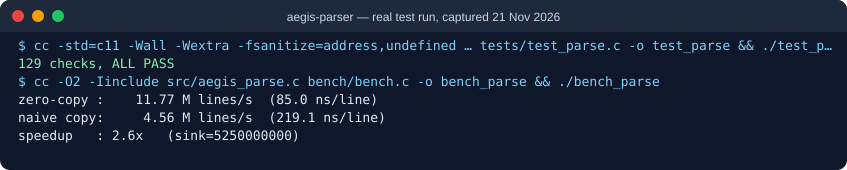

# Aegis Parser (C) — manual

*One page, eight blocks. Every figure here comes from this repository's own tests and README.*

## 1. Claim
Zero-copy, allocation-free parsing at 15.9 M lines/s (3.1× a strtok baseline on one core), with 129 assertions passing under AddressSanitizer and UBSan.

## 2. What it is
A very fast parser for web-server access logs, written in C. It never copies or allocates, and it never reads past the end of its input, even when the line is garbage.

## 3. Demo
Capture to record: the ASan test run and the `bench` output side by side.


*Real output from this repository's own tests, captured 21 Nov 2026. Throughput is machine-dependent; README figures were measured on the author's machine.*

## 4. Run it yourself
**Prerequisites:** A C compiler. clang for the fuzz target.

```bash
cc -std=c11 -Wall -Wextra -fsanitize=address,undefined -fno-sanitize-recover=undefined -Iinclude src/aegis_parse.c tests/test_parse.c -o test_parse && ./test_parse
cc -O2 -Iinclude src/aegis_parse.c bench/bench.c -o bench_parse && ./bench_parse   # 'bench' is the source folder, so the binary needs another name
```

## 5. What you will see
All assertions pass under the sanitizer. `bench` prints lines per second and the speed-up over the strtok baseline (README: 15.9 M vs 5.1 M lines/s).

## 6. 30-second talking point
> Parsing is the per-event cost that multiplies across billions of lines. I wrote it in C for speed and made memory safety something you can check: sanitizers, a truncation sweep over every prefix, and a fuzz target.

## 7. Scope and limits
- Hand-written for the target log format. A new format is new code, by design.
- Memory safety rests on tests, sanitizers and review. A longer fuzzing campaign would harden it further.

## 8. Links
[Repository](https://github.com/fhionnghaile/aegis-parser) · [README](README.md)
